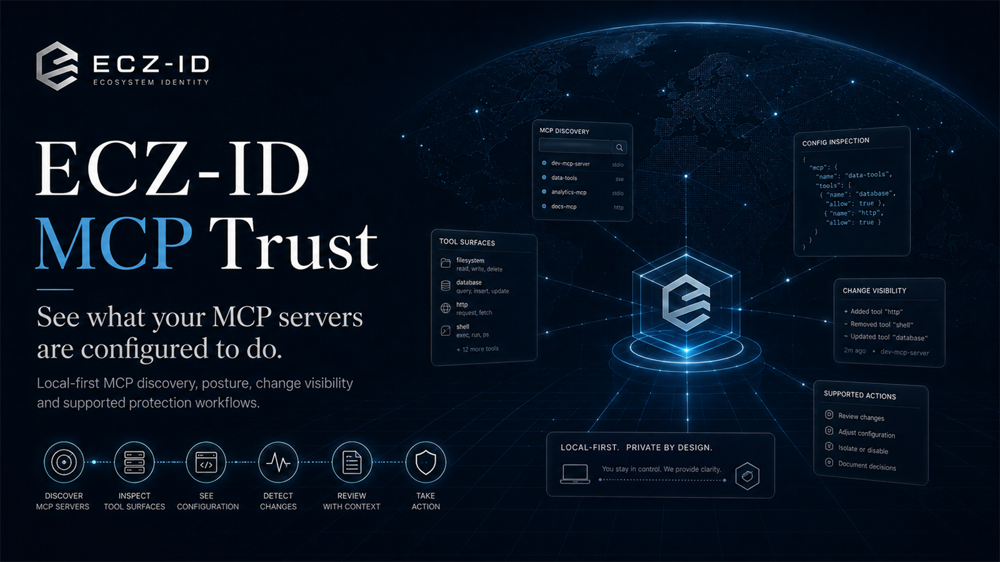

# ECZ-ID MCP Trust

**See what your MCP servers are configured to do.**

Official public product and documentation home for **ECZ-ID MCP Trust**.

[Visual Studio Marketplace](https://marketplace.visualstudio.com/items?itemName=ecocitizenz.eczid-mcp-trust) | [Open VSX](https://open-vsx.org/extension/ecocitizenz/eczid-mcp-trust) | [Product page](https://developers.ecocitizenz.com/mcp-trust/) | [Get a free MCP Passport](https://developers.ecocitizenz.com/quickstarts/mcp/?utm_source=github&utm_medium=repository&utm_campaign=mcp-trust&utm_content=free-passport) | [Developer Trust suite](https://developers.ecocitizenz.com/developer-trust/)

> Extension binaries are distributed through the marketplaces above. This repository is the official public product/documentation home and does not imply that proprietary extension source code is published here.

## What it is for

MCP Trust gives developers and reviewers a local-first way to inspect supported MCP configuration before relying on it.

### MCP Trust Community — free local review

Current Community capability includes:

- local MCP discovery and inventory,
- declared transport and configuration posture,
- environment key-name exposure,
- credential-shaped key-name warnings,
- sanitised remote endpoint display,
- local privacy-safe posture fingerprint,
- local change baseline/diff,
- VS Code Workspace Trust handling,
- local-first processing with no telemetry.

Community remains usable without a paid Developer Trust entitlement.

For current shipped capability, pricing, and plan availability use the canonical product page:

https://developers.ecocitizenz.com/mcp-trust/

## Free MCP identity

If you operate an MCP server, one logical server can receive one free ECZ-ID MCP Passport. The live public journey also creates a free Business Passport when the organisation does not already have one; no payment is taken for the free Passport journey.

[Start with the MCP Passport quickstart →](https://developers.ecocitizenz.com/quickstarts/mcp/?utm_source=github&utm_medium=repository&utm_campaign=mcp-trust&utm_content=identity)

The Passport provides identity and a public location for re-checkable current state. It is not a claim that the server is safe, approved, certified or compliant.

## MCP Trust Pro

**MCP Trust Pro** is the optional paid local Developer Trust software layer inside the existing MCP Trust extension. It adds the established advanced local controls, including:

- Protect This MCP / Local Trust Gate for supported transports;
- Secret Shield;
- Trust Epochs / local history and comparison;
- Advanced Tool X-Ray;
- deterministic local ALLOW / WARN / REVIEW / BLOCK / QUARANTINE policy;
- reviewable remediation with backup and rollback.

MCP Trust Pro does not create, replace or meter the free MCP Passport and does not issue canonical Resolver proof.

**Developer Trust Pro Bundle** unlocks both MCP Trust Pro and Agent Trust Pro.

[Explore Developer Trust →](https://developers.ecocitizenz.com/developer-trust/)

## Separate organisational product: MCP Assurance

**MCP Assurance is separate from MCP Trust Pro.** MCP Assurance / MCP Assurance Plus are higher-level organisational MCP assurance products. They are not the customer-facing name of the `MCP_TRUST_PRO` software entitlement.

MCP Assurance may be relevant when an organisation needs broader ongoing assurance beyond local developer inspection, mediation and policy controls. Buying one product does not silently create or rename the other.

## Product boundary

| Layer | Product / capability |
|---|---|
| Free local review | MCP Trust Community |
| Free durable identity | MCP Passport |
| Optional paid local Developer Trust software | MCP Trust Pro |
| Optional paid Developer Trust bundle | Developer Trust Pro Bundle — MCP Trust Pro + Agent Trust Pro |
| Separate higher-level organisational product | MCP Assurance / MCP Assurance Plus |
| Public proof | ECZ-ID Resolver |

These layers can work together, but they are not aliases for one another.

## Trust boundary

MCP Trust inspects and explains locally. It does not itself issue ECZ-ID proof, write canonical ECZ-ID truth, certify an MCP server as safe, or replace a relying party's policy.

When MCP Trust Pro shows **ENFORCED**, that state must come from current live Local Trust Gate mediation proof. Inspection alone cannot produce ENFORCED.

Resolver is the public proof surface for ECZ-ID evidence.

## Related ECZ-ID GitHub resources

- [MCP Security Toolkit](https://github.com/EcoCitizenz-Ltd/eczid-mcp-security-toolkit)
- [MCP Readiness](https://github.com/EcoCitizenz-Ltd/eczid-mcp-readiness)
- [MCP Verifier / GitHub Action](https://github.com/Ecocitizenz/ecz-id-mcp-verifier)
- [MCP & Agent Check](https://github.com/marketplace/ecz-id-mcp-agent-check)

## Public identity evidence

**ECZ-ID public identity evidence - ECZ-GB-RBS1NW**

[View current public identity and evidence](https://resolver.ecocitizenz.org/p/ECZ-GB-RBS1NW)

## Product identity

- Product: **ECZ-ID MCP Trust**
- Marketplace identity: `ecocitizenz.eczid-mcp-trust`
- Publisher: **EcoCitizenz**
- Product family: **ECZ-ID Developer Trust**
- Company: **EcoCitizenz Ltd**

## Support

See [SUPPORT.md](SUPPORT.md), [SECURITY.md](SECURITY.md), and [PRIVACY.md](PRIVACY.md).
